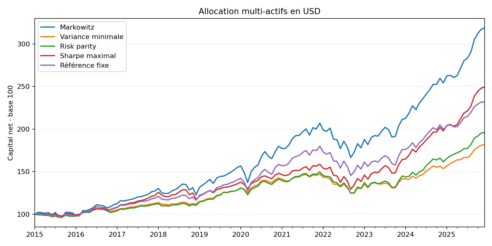

# Mouhamadou Matar Docky Diop | Portfolio de finance quantitative

Mathématiques appliquées à la finance · CY Tech  
**Projet — Allocation stratégique multi-actifs sous contraintes**

Combien de rendement un investisseur a-t-il sacrifié pour réduire son risque sur la période étudiée ? Ce projet compare quatre méthodes d'allocation et une référence fixe avec le même univers, les mêmes limites et le même calendrier.

[Classeur Excel](results/allocation.xlsx) · [Code Python](allocation.py) · [Allocations mensuelles](results/poids.csv)



## Résultats hors échantillon

131 rendements mensuels nets, de février 2015 à décembre 2025, en dollars. Le drawdown est la plus forte baisse depuis un sommet de fin de mois.

| Stratégie | Rendement annualisé composé | Volatilité annuelle | Sharpe réalisé | Drawdown maximal |
|---|---:|---:|---:|---:|
| Markowitz | 11,21 % | 10,54 % | 0,87 | −19,50 % |
| Variance minimale | 5,62 % | 5,83 % | 0,63 | −15,30 % |
| Risk parity | 6,35 % | 6,99 % | 0,63 | −16,64 % |
| Sharpe maximal | 8,73 % | 8,29 % | 0,81 | −18,52 % |
| Référence fixe | 8,00 % | 8,83 % | 0,69 | −19,15 % |

Markowitz détenait en moyenne 58,5 % d’actions américaines, près du plafond de 60 %. Il termine en tête en rendement avec la plus forte volatilité. La variance minimale plaçait en moyenne 70 % en obligations et a subi une baisse maximale de 15,30 %. Le mandat obligataire a donc atteint sa borne supérieure. Le portefeuille de Sharpe maximal a dépassé la référence fixe en rendement avec une volatilité plus basse, au prix d’une rotation annuelle de 40,44 % contre 11,12 %.

## Univers et mandat

| Exposition | ETF | Minimum | Maximum | Référence |
|---|---|---:|---:|---:|
| Actions américaines de grande capitalisation | SPY | 10 % | 60 % | 40 % |
| Obligations américaines investment grade | AGG | 20 % | 70 % | 40 % |
| Or | GLD | 0 % | 25 % | 10 % |
| Immobilier américain coté | VNQ | 0 % | 20 % | 10 % |

Chaque portefeuille est investi à 100 %, sans vente à découvert ni levier. Les limites s'appliquent au rééquilibrage. L'immobilier coté représente ici une poche alternative liquide, exposée aussi au marché actions.

## Construction des stratégies

Les rendements simples mensuels donnent une moyenne arithmétique μ et une covariance Σ annualisées par multiplication par 12. Pour des poids w, la variance anticipée vaut v = wᵀΣw. SciPy résout chaque problème sous les contraintes du tableau.

- **Markowitz** maximise wᵀμ − λv/2 avec λ = 4. Augmenter λ pénalise davantage le risque.
- **Variance minimale** minimise v. L'estimation du rendement futur n'intervient pas dans cet objectif.
- **Risk parity** rapproche chaque part de risque wᵢ(Σw)ᵢ/v de 25 %, en minimisant la somme des écarts au carré. Les bornes peuvent empêcher l'égalité exacte.
- **Sharpe maximal** maximise (wᵀμ − 2 %)/√v. Le Sharpe réalisé utilise ensuite les rendements nets observés.
- **Référence fixe** revient aux poids 40/40/10/10 chaque mois.

## Protocole et limites

Les cours ajustés de fin de mois proviennent des clôtures quotidiennes ajustées de Yahoo Finance, de janvier 2010 à décembre 2025. Le CSV figé permet de reproduire le résultat hors ligne. Le fournisseur peut réviser son historique. [Script de collecte et URL source](download.py)

1. À chaque fin de mois, estimer μ et Σ avec les 60 derniers rendements connus. La première décision utilise février 2010 à janvier 2015.
2. Calculer les cibles et comparer ces poids aux poids ayant dérivé avec le marché. La rotation vaut la moitié de la somme des écarts absolus.
3. Appliquer 10 points de base par unité de rotation, hors mise en place initiale. Le facteur de capitalisation net vaut (1 − coût) × (1 + rendement brut).
4. Capitaliser les rendements nets. La volatilité est l'écart-type mensuel multiplié par √12. Le Sharpe réalisé utilise le rendement moyen annualisé diminué du taux fixe de 2 %.

Les poids sont supposés exécutables au cours de clôture servant au calcul. Un délai d'exécution ou des coûts variables modifieraient les chiffres. Les moyennes estimées sur cinq ans peuvent être instables. La période, l’univers américain et le taux sans risque constant limitent la portée du classement. Les baisses intramensuelles ne figurent pas dans le drawdown.

## Reproduire et explorer

Depuis ce dossier avec Python 3.11 ou ultérieur compatible avec les versions épinglées :

```bash
python -m pip install -r requirements.txt
python allocation.py
```

Le script actualise les CSV et le graphique dans results/. Le classeur fourni est un instantané des résultats. Pour le régénérer dans un environnement Node disposant de @oai/artifact-tool, exécuter node excel.mjs. La collecte facultative se relance avec python download.py.

Pour explorer l’effet du mandat, modifier BOUNDS, AVERSION, RF, COST ou WINDOW dans allocation.py. Conserver la référence fixe compatible avec les nouvelles bornes. Les fichiers transactions.csv et capital.csv permettent de réconcilier le rendement net de chaque mois avec l’évolution du portefeuille.
